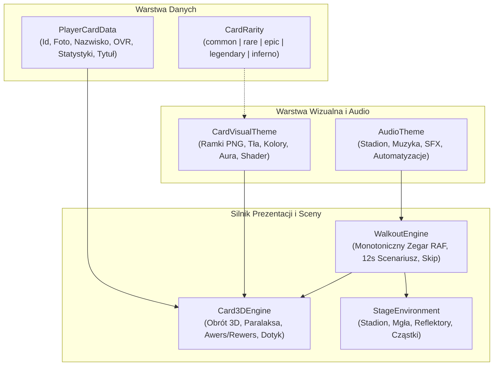
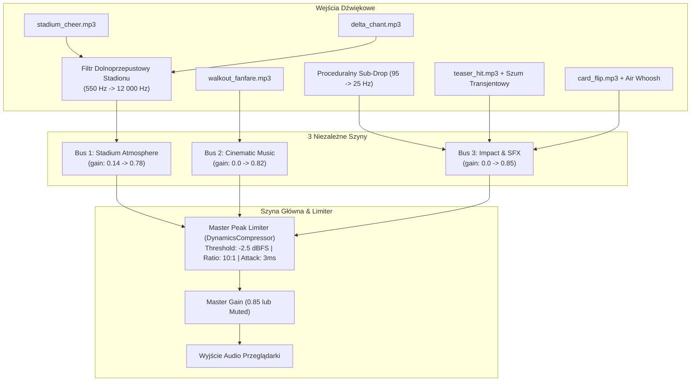
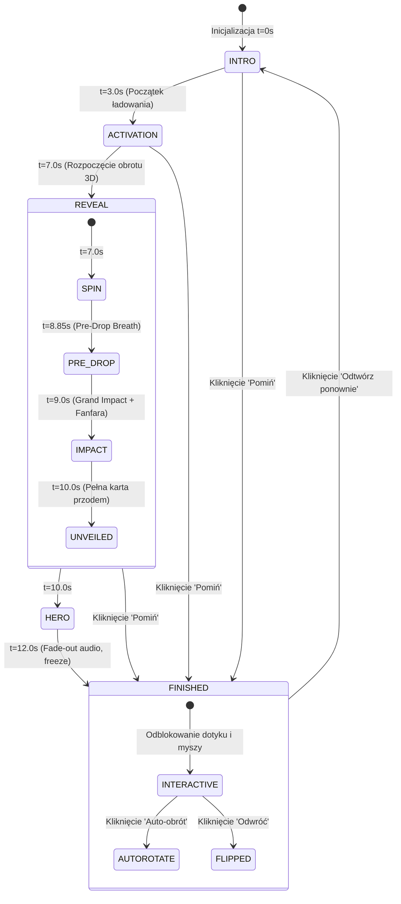

# DELTA 2018 GM — COLLECTION 3D ENGINE
## DOKUMENT ARCHITEKTURY TECHNICZNEJ (ETAP 1)

**Status:** Zaakceptowany Baseline & Specyfikacja Architektury  
**Data utworzenia:** 10 października 2026 r.  
**Gałąź robocza Git:** `gemini/collection-3d-engine`  
**Commit Baseline V3.1:** `fa64208d6eb32645f7e4f04d13133d175fdef495`  
**Lokalizacja:** `docs/DELTA_COLLECTION_3D_ENGINE_ARCHITECTURE.md`  

---

## 1. Wstęp i Cel Architektury

W oparciu o ukończony i przetestowany prototyp **INFERNO WALKOUT V3.1** (dostępny pod adresem `/lab/inferno-walkout`), niniejszy dokument definiuje uniwersalną, skalowalną architekturę **DELTA COLLECTION 3D ENGINE**.

Celem silnika jest dostarczenie jednolitego ekosystemu kart kolekcjonerskich 3D klasy AAA dla całego projektu DELTA 2018 GM:
1. **Prezentacji kart 3D** z fizyczną głębią, warstwami paralaksy i płynnym obrotem dotykowym/myszą.
2. **Kinowych animacji WALKOUT (12 s)** dla najrzadszych kart z autorskim masteringiem audio Web Audio API.
3. **Scen ekspozycyjnych (Stage Environment)** reagujących na stan karty i oświetlenie stadionu.
4. **Bezpiecznej integracji** z produkcyjną aplikacją DELTA Collection bez modyfikacji bazy danych Supabase i bez regresji w istniejących modułach.

---

## 2. Podział Odpowiedzialności i Zasady Architektoniczne

Silnik opiera się na **6 niezależnych modułach (Separation of Concerns)**:



### Kluczowe Zasady:
1. **Niezależność Typu Wizualnego od Rzadkości**: Typ wizualny karty (`CardVisualType`) określa styl ramki, tła i shaderów (np. `BASE`, `GOLD_MASTER`, `INFERNO_ULTRA`). Rzadkość (`CardRarity`) określa ekonomiczną wartość w grze (`common` ... `inferno`). Ta sama rzadkość (np. `rare`) może mieć różne skórki tematyczne (np. `MATCHDAY_HERO` lub `TRAINING_HERO`).
2. **Monotoniczny Zegar Czasu**: Wszelkie animacje WALKOUT opierają się na `requestAnimationFrame` z czasem bezwzględnym $t \in [0.0, 12.0\text{ s}]$, co eliminuje mikro-stutters, zapętlenia i błędy asynchroniczne.
3. **Wieloszynowe Audio z Master Limiterem**: Tor audio rozdzielony na 3 szyny (`Stadium`, `Music`, `SFX`) sumujące się w `DynamicsCompressorNode` (-2.5 dBFS, 10:1), zapobiegając przesterowaniu sygnału.
4. **Respektowanie Urządzeń Mobilnych i Dostępności**: Automatyczne skalowanie z zachowaniem proporcji (viewport 390×844 px) oraz pełne wsparcie dla `prefers-reduced-motion`.

---

## 3. Kontrakty i Interfejsy TypeScript

Poniższe interfejsy stanowią kanoniczny kontrakt API przyszłego pakietu `@/components/collection-3d`:

### 3.1. Dane Zawodnika (`PlayerCardData`)
```typescript
export interface PlayerStats {
  pac: number; // Tempo
  sho: number; // Strzał
  pas: number; // Podania
  dri: number; // Drybling
  def: number; // Defensywa
  phy: number; // Fizyczność
}

export interface SpecialTitleBadge {
  id: string;
  name: string;
  category: "captain" | "hattrick" | "mvp" | "training" | "matchday" | "milestone";
  badgeIcon: string;
  badgeClass: string;
}

export interface PlayerCardData {
  id: string;
  playerId: string;
  name: string;
  number: number | string;
  position: "FWD" | "MID" | "DEF" | "GK";
  overall: number; // 50–99
  stats: PlayerStats;
  playerImage: string; // Przezroczysty PNG
  specialTitle?: SpecialTitleBadge | null;
  season?: string; // np. "2026/2027"
}
```

### 3.2. Typy Wizualne i Motywy Kart (`CardVisualTheme`)
```typescript
export type CardVisualType =
  | "BASE"            // Standardowa karta klubowa
  | "MATCHDAY_HERO"   // Wyróżnienie meczowe
  | "GOLD_MASTER"     // Złota karta mistrzowska
  | "DELTA_ICON"      // Legenda / Ikona klubu
  | "INFERNO_ULTRA"   // Płonąca karta najrzadsza
  | "TRAINING_HERO"   // Bohater treningu
  | "STAR_PLAYER"     // Gracz tygodnia / MVP
  | "SEASONAL_EVENT"; // Okolicznościowa (zima/turniej)

export interface CardVisualTheme {
  type: CardVisualType;
  displayName: string;
  assets: {
    frameImg: string;      // Zewnętrzna ozdobna ramka PNG
    frontBg: string;       // Grafika tła awersu
    backBg: string;        // Grafika tła rewersu
    fxImg?: string;        // Warstwa nakładki holograficznej
    crestImg?: string;     // Herb DELTA na rewersie
  };
  style: {
    primaryColor: string;  // np. "#ff2a2a" dla Inferno, "#f59e0b" dla Gold
    secondaryColor: string;
    glowColor: string;
    holoFoilIntensity: number; // 0.0 – 1.0
    slabDepthPx: number;   // Grubość bocznej krawędzi (np. 15px)
  };
}
```

### 3.3. Silnik Karty 3D (`Card3DEngineProps`)
```typescript
export interface Card3DEngineProps {
  data: PlayerCardData;
  theme: CardVisualTheme;
  yaw?: number;            // Kąt w osi Y (-180° do +180°)
  pitch?: number;          // Kąt w osi X (-30° do +30°)
  isFlipped?: boolean;     // Czy pokazać rewers
  interactive?: boolean;   // Czy reagować na przeciąganie myszą/palcem
  autoRotate?: boolean;    // Płynny obrót ekspozycyjny
  isRevealing?: boolean;   // Stan wzbudzenia aury / rozbłysku
  className?: string;
  onRotationChange?: (yaw: number, pitch: number) => void;
}
```

### 3.4. Silnik Kinowego Walkoutu (`WalkoutEngineConfig`)
```typescript
export type WalkoutPhase = "intro" | "activation" | "reveal" | "hero";

export interface WalkoutSchedule {
  totalDurationMs: 12000;
  phases: {
    intro: [0, 3000];       // 0–3 s: Ciemna arena, odległy rewers
    activation: [3000, 7000]; // 3–7 s: Ładowanie energii, podświetlenie
    reveal: [7000, 10000];   // 7–10 s: Obrót 3D, kulminacyjny impact (9s)
    hero: [10000, 12000];   // 10–12 s: Prezentacja, wejście w tryb interaktywny
  };
}

export interface WalkoutEngineProps {
  cardData: PlayerCardData;
  theme: CardVisualTheme;
  audioTheme?: AudioThemeConfig;
  onComplete?: () => void;
  onSkip?: () => void;
  onReplay?: () => void;
}
```

### 3.5. Środowisko Sceny (`StageEnvironmentConfig`)
```typescript
export interface StageEnvironmentConfig {
  arenaType: "stadium_night" | "showroom_dark" | "indoor_arena";
  backgroundImage: string;
  reflectorColors: [string, string];
  mistDensity: number; // 0.0 – 1.0
  particlesActive: boolean;
  pulseActive: boolean;
}
```

---

## 4. Matryca Typów Kart i Rzadkości DELTA Collection

W oparciu o istniejący system (`lib/cards/types.ts` i `lib/cards/central-types.ts`):

| Typ Wizualny (`CardVisualType`) | Kategoria | Domyślna Rzadkość | Dostępne Rzadkości | Charakterystyka Wizualna |
|---|---|---|---|---|
| **BASE** | Standard | `common` | `common`, `rare` | Matowy grafit, stalowe krawędzie, herb klubu, subtelna biel |
| **MATCHDAY_HERO** | Mecz | `rare` | `rare`, `epic` | Głęboki granat, stadionowe neonowe linie, błękitny blask |
| **TRAINING_HERO** | Trening | `rare` | `rare` | Szmaragdowa zieleń, stalowe okucia, motyw potu i wysiłku |
| **GOLD_MASTER** | Sukces | `epic` | `epic`, `legendary` | Polerowane złoto, refleksy świetlne, złoty herb, korona |
| **DELTA_ICON** | Ikona | `legendary` | `legendary` | Platyna ze złotem, gwiazdy mistrzowskie, królewska aura |
| **INFERNO_ULTRA** | Płomień | `inferno` | `inferno` | Karbon, pulsująca lawa, iskry, monumentalny rozbłysk |
| **STAR_PLAYER** | MVP | `epic` | `rare`, `epic` | Fioletowo-srebrny gradient, diamentowy połysk |
| **SEASONAL_EVENT** | Specjalna | `epic` | `epic`, `legendary` | Zmienna tematyka (Zima, Finały, Turniej, Obóz) |

---

## 5. Architektura Toru Audio (`AudioTheme`)



---

## 6. Cykl Życia i Maszyna Stanów WALKOUT



---

## 7. Plan Wdrożenia (Roadmapa Kolejnych Etapów)

1. **Etap 1 (Bieżący — Ukończony)**:
   - Utworzenie gałęzi `gemini/collection-3d-engine`.
   - Zabezpieczenie commita bazowego V3.1 (`fa64208d`).
   - Poprawka rozbłysku (Final Flash Fix) eliminująca białą poświatę.
   - Opracowanie niniejszego dokumentu architektury.
2. **Etap 2 — Refaktoryzacja Komponentu Bazowego**:
   - Wyodrębnienie `components/collection-3d/Card3D.tsx` z prototypu `InfernoCard3D`.
   - Utworzenie `CardThemeRegistry` mapującego skórki PNG na parametry wizualne.
3. **Etap 3 — Rejestr Tematów Wizualnych**:
   - Przygotowanie motywów dla `BASE`, `MATCHDAY_HERO`, `GOLD_MASTER`, `DELTA_ICON`.
   - Wykorzystanie istniejących grafik PNG z `public/assets/cards/`.
4. **Etap 4 — Integracja z DELTA Collection & Pack Opening**:
   - Podpięcie `WalkoutEngine` pod ekran otwierania paczek `/dev/pack-opening`.
   - Zachowanie pełnej kompatybilności wstecznej dla kart 2D.
