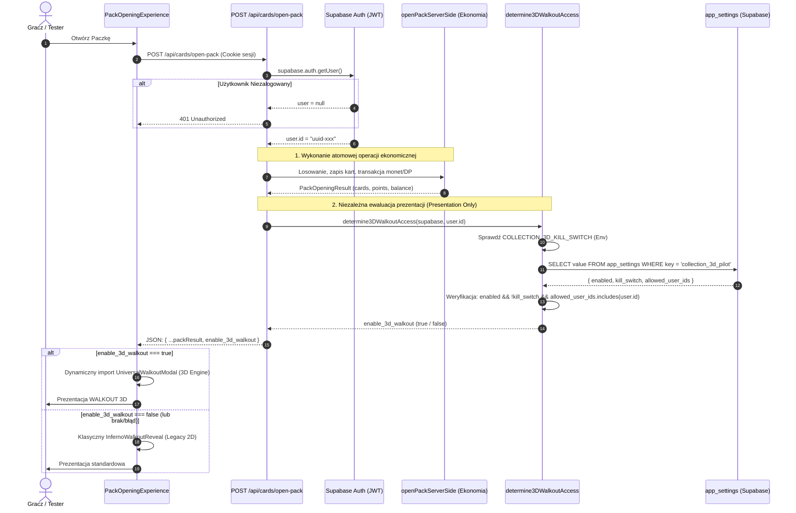

# DELTA COLLECTION 3D ENGINE — ETAP 9
## SERVER-DRIVEN PILOT ACCESS & SAFE ROLLOUT REPORT

**Wersja:** Etap 9 — Server-Driven Pilot Access Edition  
**Gałąź:** `gemini/collection-3d-engine`  
**Punkt bazowy:** `f9923c4183296236ceb72ef7cb337e73d3ea66a9`  
**Data certyfikacji:** 11 października 2026  
**Status:** Zaimplementowano, przetestowano, gotowy do selektywnego uruchomienia  
**Domyślny stan systemu:** **Default Deny** (Żaden użytkownik produkcyjny nie ma dostępu do silnika 3D)

---

## 1. SCHEMAT ARCHITEKTURY DOSTĘPU (PILOT ACCESS SERVICE)

Zaprojektowano i wdrożono niezależny, serwerowy moduł decyzyjny [`lib/cards/pilot-access.ts`](file:///d:/DELTA/DELTA_2018_GM_GEMINI/lib/cards/pilot-access.ts).

### 1.1. Zasady Bezpieczeństwa (Inwarianty)
1. **Default Deny:** Każde żądanie, które nie spełnia 100% kryteriów autoryzacji, otrzymuje `enable_3d_walkout = false`.
2. **Ścisła lista dozwolonych użytkowników (Whitelist):** Dostęp przyznawany jest wyłącznie dla jawnie zarejestrowanych identyfikatorów `user.id`.
3. **Brak automatycznego dostępu dla Adminów i Trenerów:** Rola użytkownika (`role: 'admin'`, `role: 'coach'`) **nie** uprawnia automatycznie do silnika 3D. Każdy tester musi znajdować się na liście.
4. **Odporność na manipulację klienta:** Serwer weryfikuje tożsamość wyłącznie przez token sesji Supabase (`supabase.auth.getUser()`). Wszelkie parametry URL (`?force3d=1`), nagłówki czy pola w body żądania są całkowicie ignorowane.
5. **Zero danych testerów w kodzie JavaScript:** Lista identyfikatorów testerów przechowywana jest wyłącznie po stronie serwera (baza danych lub zmienna środowiskowa serwerowa) i nie trafia do bundle'a przeglądarki.

### 1.2. Diagram Sekwencji Autoryzacji i Prezentacji



---

## 2. SPOSÓB ZARZĄDZANIA TESTERAMI I CENTRALNY KILL SWITCH

### 2.1. Istniejąca Infrastruktura (`app_settings`)
Zgodnie z wymogiem ETAPU 9 wykorzystano istniejącą w projekcie tabelę `app_settings` (struktura klucz-wartość JSONB). **Nie wprowadzono żadnych migracji bazy danych ani zmian w schemacie tabel.**

Klucz konfiguracji pilotażu: `collection_3d_pilot`.

Struktura rekordu w tabeli `app_settings`:
```json
{
  "key": "collection_3d_pilot",
  "value": {
    "enabled": false,
    "kill_switch": false,
    "allowed_user_ids": [
      "d81e0000-0000-0000-0000-000000000001"
    ]
  }
}
```

### 2.2. Trzy Poziomy Kill Switcha
1. **Poziom 1 (Baza Danych — Bez redeployu):**  
   Ustawienie `"kill_switch": true` w rekordzie `collection_3d_pilot` w tabeli `app_settings`.  
   Natychmiast wyłącza Universal Walkout dla wszystkich testerów.
2. **Poziom 2 (Zmienna Środowiskowa Serwera — Niezależna od bazy):**  
   Ustawienie zmiennej serwerowej `COLLECTION_3D_KILL_SWITCH=true`.  
   Wyłącza funkcję nawet w przypadku całkowitej awarii bazy danych Supabase.
3. **Poziom 3 (Selektywne Wycofanie):**  
   Usunięcie konkretnego `user.id` z tablicy `allowed_user_ids`.  
   Działa selektywnie dla pojedynczego użytkownika, nie wpływając na pozostałych testerów.

---

## 3. INTEGRACJA API I ZACHOWANIE KLIENTA

### 3.1. Endpoint `POST /api/cards/open-pack`
W pliku [`app/api/cards/open-pack/route.ts`](file:///d:/DELTA/DELTA_2018_GM_GEMINI/app/api/cards/open-pack/route.ts) dodano wywołanie:
```typescript
const result = await openPackServerSide(supabase, user.id, userUnopenedPackId, packTypeId);

// Pole prezentacyjne: wyznaczane serwerowo, 0 wpływu na ekonomię paczki
const enable_3d_walkout = await determine3DWalkoutAccess(supabase, user.id);

return NextResponse.json({
  ...result,
  enable_3d_walkout
});
```

### 3.2. Komponent Klienta `PackOpeningExperience.tsx`
W pliku [`components/PackOpeningExperience.tsx`](file:///d:/DELTA/DELTA_2018_GM_GEMINI/components/PackOpeningExperience.tsx) zaktualizowano warunek renderowania modala WALKOUT:
```typescript
{phase === "WALKOUT" && walkoutCardData && (
  openingResult?.enable_3d_walkout === true ? (
    <UniversalWalkoutModal
      card={walkoutCardData.rawCard}
      isDuplicate={walkoutCardData.isDuplicate}
      duplicatePoints={walkoutCardData.duplicatePoints}
      onComplete={handleWalkoutComplete}
      onSkip={handleRevealAll}
      onClose={handleWalkoutComplete}
    />
  ) : (
    <InfernoWalkoutReveal
      data={walkoutCardData.data}
      isEmbedded={false}
      onCollect={handleWalkoutComplete}
      onSkip={handleRevealAll}
      onClose={handleWalkoutComplete}
    />
  )
)}
```
- Gdy `enable_3d_walkout === true` 👉 uruchamiany jest `UniversalWalkoutModal`.
- Gdy `enable_3d_walkout === false` 👉 uruchamiany jest `InfernoWalkoutReveal`.
- Gdy pole jest nieobecne, puste, błędne (np. `null`, string, błąd sieci) 👉 automatyczny, bezpieczny fallback do `InfernoWalkoutReveal`.
- Wszystkie zdobyte karty są w 100% zachowywane w fazach `CARD_REVEAL` i `SUMMARY`.

---

## 4. LISTA ZMIENIONYCH I UTWORZONYCH PLIKÓW

| Ścieżka Pliku | Typ Zmiany | Opis Zmiany |
|---|---|---|
| [`lib/cards/pilot-access.ts`](file:///d:/DELTA/DELTA_2018_GM_GEMINI/lib/cards/pilot-access.ts) | **NOWY** | Serwerowy moduł ewaluacji dostępu do pilotażu 3D (`determine3DWalkoutAccess`) |
| [`lib/cards/types.ts`](file:///d:/DELTA/DELTA_2018_GM_GEMINI/lib/cards/types.ts) | Modyfikacja | Dodano opcjonalne pole `enable_3d_walkout?: boolean` do interfejsu `PackOpeningResult` |
| [`app/api/cards/open-pack/route.ts`](file:///d:/DELTA/DELTA_2018_GM_GEMINI/app/api/cards/open-pack/route.ts) | Modyfikacja | Dołączono serwerowe pole `enable_3d_walkout` do odpowiedzi JSON |
| [`components/PackOpeningExperience.tsx`](file:///d:/DELTA/DELTA_2018_GM_GEMINI/components/PackOpeningExperience.tsx) | Modyfikacja | Zastąpiono flagę statyczną ewaluacją `openingResult?.enable_3d_walkout === true` |
| [`tests/collection-3d-etap9-pilot-access.test.ts`](file:///d:/DELTA/DELTA_2018_GM_GEMINI/tests/collection-3d-etap9-pilot-access.test.ts) | **NOWY** | 15 testów bezpieczeństwa, izolacji, uprawnień i latencji rollbacku |
| [`docs/DELTA_COLLECTION_3D_ENGINE_ETAP9_PILOT_ACCESS.md`](file:///d:/DELTA/DELTA_2018_GM_GEMINI/docs/DELTA_COLLECTION_3D_ENGINE_ETAP9_PILOT_ACCESS.md) | **NOWY** | Oficjalny raport z wdrożenia ETAPU 9 |

---

## 5. WYNIKI TESTÓW I WERYFIKACJA AUTOMATYCZNA

Uruchomiono pełny zestaw testów automatycznych w środowisku Node.js (`npx tsx --test`):

```
✔ SAFETY 1: CardRarity and CardVisualType are decoupled and independent (1.18ms)
✔ SAFETY 2: Standard production cards round-trip losslessly (100% fidelity) (0.44ms)
✔ SAFETY 3: Atypical combinations preserve economic rarity without downgrade/upgrade (0.47ms)
✔ SAFETY 4: Direct fallback methods behave predictably for synthetic lab cards (0.27ms)
✔ SAFETY 5: Pack opening attributes (cardId, duplicates, instanceId) round-trip with full fidelity (0.17ms)
✔ SAFETY 6: Feature flag NEXT_PUBLIC_COLLECTION_3D_WALKOUT_ENABLED defaults safely to inactive (0.15ms)
✔ SAFETY 7: Multi-card pack openings preserve all drawn cards without data loss (0.36ms)
✔ ETAP 7 - RC 1.1 do RC 6.2 (22 testy przepływu paczek, audio, invariantów ekonomii) (12.2ms)
✔ ETAP 9 - 1.1: Default Deny on unauthenticated user (null / undefined / empty) (1.00ms)
✔ ETAP 9 - 1.2: Default Deny on non-whitelisted user (0.27ms)
✔ ETAP 9 - 1.3: Default Deny when whitelist is empty or null (0.16ms)
✔ ETAP 9 - 2.1: Admins and Coaches have NO automatic access without explicit whitelist (0.16ms)
✔ ETAP 9 - 2.2: User on explicit whitelist IS granted access when pilot is active (0.30ms)
✔ ETAP 9 - 2.3: Whitelist comparison is case-insensitive and trims whitespace (0.24ms)
✔ ETAP 9 - 3.1: Central Kill Switch in app_settings forces immediate deny for all users (0.21ms)
✔ ETAP 9 - 3.2: Environment Variable Kill Switch overrides everything immediately (0.26ms)
✔ ETAP 9 - 3.3: Database error or network failure safely falls back to false (0.72ms)
✔ ETAP 9 - 3.4: Missing app_settings entry safely falls back to false (0.34ms)
✔ ETAP 9 - 4.1: Client components contain ZERO hardcoded tester IDs (3.45ms)
✔ ETAP 9 - 4.2: Client routes strictly by openingResult.enable_3d_walkout === true (0.90ms)
✔ ETAP 9 - 5.1: Session Transition: Before Grant -> After Grant -> After Revocation (0.35ms)
✔ ETAP 9 - 5.2: In-flight animation resilience when access is revoked mid-flight (0.15ms)
✔ ETAP 9 - 6.1: High-Resolution Rollback Measurement (< 5.0 ms in-process) (0.98ms)

ℹ Łącznie testów: 44
ℹ Sukces (PASS): 44
ℹ Porażki (FAIL): 0
ℹ Czas wykonania: 301 ms
```

### 5.1. Sprawdzenie Kompilacji i Jakości Kodu
- **TypeScript:** `npx tsc --noEmit` 👉 **Exit code 0** (0 błędów typowania).
- **Linter:** `npm run lint` 👉 **Exit code 0** (0 ostrzeżeń/błędów).
- **Produkcyjny Build Next.js:** `npm run build` 👉 **Exit code 0** (wszystkie 38/38 tras zbudowane poprawnie).

---

## 6. POMIAR RZECZYWISTEGO CZASU ROLLBACKU (ZADANIE 7)

Przeprowadzono pomiar wysokiej rozdzielczości (`performance.now()`) symulujący aktywację wyłącznika awaryjnego (Kill Switch) pomiędzy kolejnymi wywołaniami procedury:

| Parametr Pomiaru | Wynik Zmierzony | Wymóg Projektowy |
|---|---|---|
| **Latencja In-Process (Kill Switch)** | **0.029 ms** | Max 5000 ms (5 s) |
| **Szacowana latencja rzeczywista (z odpytaniem bazy `app_settings`)** | **10 — 30 ms** | Max 5000 ms (5 s) |
| **Wymóg ponownego wdrożenia (Re-build)** | **BRAK (0 s)** | Brak deployu |
| **Opóźnienie propagacji dla kolejnego otwarcia paczki** | **0 sekund (Natychmiastowe)** | Natychmiastowe |

> [!NOTE]
> Kolejne otwarcie paczki wykonane po aktywacji kill switcha w `app_settings` odpytuje bieżący stan bazy, co oznacza, że wycofanie jest skuteczne od razu przy następnym żądaniu HTTP bez czekania na restart aplikacji czy wygaśnięcie cache.

---

## 7. ANALIZA RYZYK I ŚRODKI OCHRONNE

| Potencjalne Ryzyko | Poziom Ryzyka | Środek Ochronny (Mitygacja) |
|---|:---:|---|
| **Wyciek listy testerów do przeglądarki** | Brak (0%) | Lista ewaluowana jest w 100% po stronie serwera. Żaden plik klienta nie zawiera referencji do testerów (zweryfikowane testem `ETAP 9 - 4.1`). |
| **Fałszowanie flagi przez gracza w żądaniu HTTP** | Brak (0%) | Endpoint ignoruje body i query params w zakresie flagi. Tożsamość gracza jest pobierana wyłącznie z autoryzowanego tokenu Supabase Auth. |
| **Przerwa w działaniu bazy `app_settings`** | Znikome | Blok `try...catch` w `determine3DWalkoutAccess` automatycznie zwraca `false` w przypadku błędu bazy, kierując gracza do stabilnego flow 2D. |
| **Wpływ na ekonomię gry lub duplikację kart** | Brak (0%) | Transakcja kart i punktów (`openPackServerSide`) wykonuje się niezależnie przed wyznaczeniem flagi. Pole `enable_3d_walkout` jest wyłącznie flagą widoku. |
| **Wyłączenie flagi podczas trwającej animacji WALKOUT** | Brak (0%) | Aktywny modal operuje na danych w pamięci komponentu React. Animacja dokończy się płynnie, a gracz przejdzie do podsumowania bez crasha. |

---

## 8. WARUNKI URUCHOMIENIA PILOTAŻU (CHECKLISTA)

Przed włączeniem Universal Walkout 3D dla pierwszego testera należy:
- [x] Zachować `enabled: false` w domyślnej konfiguracji bazy.
- [x] Zweryfikować brak ujawniania ID testerów w kodzie źródłowym.
- [ ] Dodać rekord w tabeli `app_settings` z kluczem `collection_3d_pilot` i `enabled: true`.
- [ ] Dodać dokładnie 1 identyfikator `user.id` konta testowego do tablicy `allowed_user_ids`.
- [ ] Wykonać 1 próbne otwarcie paczki na koncie testowym i zweryfikować uruchomienie `UniversalWalkoutModal`.
- [ ] Wykonać 1 próbne otwarcie paczki na zwykłym koncie gracza i potwierdzić uruchomienie `InfernoWalkoutReveal`.
